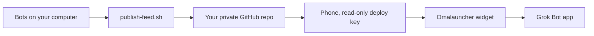

# Grok Bot widget for Omalauncher

A home-screen widget of your Grok Bots, built for [Omalauncher](https://omalauncher.app) (the OWL widget language). You tap a bot and it opens in the Grok Bot app. Unread Grok Bot notifications show on the row.

Your bots are listed from a feed that **your** Grok Bot computer builds and pushes to **your** private GitHub repository. The phone clones that repository with a **read-only** deploy key. The author of this kit does not host the feed, the widget data, or an account in the middle.


*Screenshot placeholder. Replace `docs/screenshot.svg` with a capture of the widget on your home screen.*

## How it works



The feed is `index.json` (schema version 1) plus 128×128 avatar thumbnails. Descriptions are left out unless you opt in. Server ids, harness, voice ids, secrets, skills, and memory are never written.

## Quick start

Import the setup bot template (the bot whose skill is `omalauncher-widget-setup`) and follow it. It asks one question at a time: Omalauncher on Android, GitHub CLI login, a private repo name, a pinned release, the phone's public key, and which bot to pin.

It will not ask you to paste a GitHub token or a private key. If `gh` is not logged in, it hands you the computer so you can run `gh auth login` yourself.

## Manual install

You need Python 3, `git`, and the GitHub CLI (`gh`) on the Grok Bot computer. Pillow (`pip install Pillow`) is optional; without it, avatars are skipped and the widget draws a mark from each bot's color and shape. The phone needs Omalauncher with `git` and `openssh`, plus notification access if you want unread dots.

1. Clone a **pinned tag** of this repository. Do not follow a moving branch.
2. Check the tree before you run anything:

   ```sh
   sha256sum -c checksums.txt
   ```

   Stop if any line is not `OK`.
3. Publish the feed. `OWNER/NAME` must be private. The script refuses a public repo, creates one private repo if it is missing, and pushes only when the feed changed.

   ```sh
   scripts/publish-feed.sh --repo OWNER/NAME
   ```

   The checkout on this computer is `/workspace/grokbot-widget-feed`.
4. On the phone, in Omalauncher's terminal:

   ```sh
   ssh-keygen -t ed25519 -f ~/grokbot-feed -N ""
   cat ~/grokbot-feed.pub
   ```

   On the computer, add that single public line as a read-only deploy key:

   ```sh
   scripts/add-phone-key.sh --repo OWNER/NAME
   ```

5. Edit the settings block at the top of `widget/grokbot.owl`: the feed SSH URL (`git@github.com:OWNER/NAME.git`), an optional pinned bot name, and the refresh interval (`every 10m`). Import the file in Omalauncher.

Run `scripts/publish-feed.sh` again whenever bots change, or schedule it every few hours and stay quiet unless it fails. `scripts/update-checksums.sh` rewrites `checksums.txt` after you change the widget or the scripts. Run it before you tag a release.

`--include-descriptions` adds scrubbed descriptions. Leave it off. Descriptions often contain private instructions, and scrubbing can miss a secret.

## Security model

Your data stays in three places you control:

- the Grok Bot computer, which already has your bots
- your private GitHub repository
- your phone, which can only read that repository

Nothing is hosted by the author of this kit. Details, residual risk, and how to report a problem are in [SECURITY.md](SECURITY.md). The license is [MIT](LICENSE).
