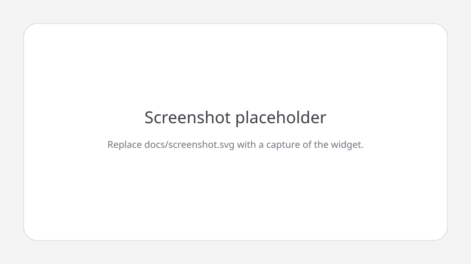
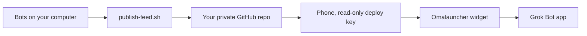

# Your Grok Bots, on your home screen

*Grok Bot Home Widget, for Omalauncher*

A Grok Bot widget for [Omalauncher](https://github.com/SimonSchubert/omalauncher) on Android. Pin your favorite bots, scroll the rest, and tap any bot to open its chat. Unread dots show you which bots have something new, so you don't have to open the app to check.

Setup takes one conversation. Import the setup bot, answer a few questions, and it builds everything on your Grok Bot computer. Your bot list goes only to a private GitHub repo you own, and your phone gets read-only access to it. Nothing passes through us.



*Screenshot placeholder. Replace `docs/screenshot.svg` with a capture of the widget on your home screen.*

## How it works



The feed is `index.json` (schema version 1) plus 128×128 avatar thumbnails. Descriptions are left out unless you opt in. Server ids, harness, voice ids, secrets, skills, and memory are never written.

## Quick start

You'll need:
- an Android phone with Omalauncher, with its optional Linux installed (the widget runs `git` there)
- a free GitHub account
- about 10 minutes

Import the Widgety setup bot template and say hi. It asks one thing at a time, explains each step in plain words, and does the technical work for you. You'll do two things yourself: sign in to GitHub when it hands you the screen, and copy one line from your phone back to it.

It will never ask for a password, a GitHub token or a private key. If anything asks you for one, stop.

## Manual install

You need Python 3, `git`, and the GitHub CLI (`gh`) on the Grok Bot computer. Pillow (`pip install Pillow`) is optional; without it, avatars are skipped and the widget draws a mark from each bot's color and shape. The phone needs Omalauncher with `git` and `openssh`, plus notification access if you want unread dots.

1. Clone a **pinned tag** of this repository. Do not follow a moving branch.
2. Check the tree before you run anything:

   ```sh
   sha256sum -c checksums.txt
   ```

   Stop if any line is not `OK`.
3. Publish the feed. `OWNER/NAME` must be private. The script refuses a public repo, creates one private repo if it is missing, and pushes only when the feed changed.

   ```sh
   scripts/publish-feed.sh --repo OWNER/NAME
   ```

   The checkout on this computer is `/workspace/grokbot-widget-feed`.
4. On the phone, in Omalauncher's terminal:

   ```sh
   ssh-keygen -t ed25519 -f ~/grokbot-feed -N ""
   cat ~/grokbot-feed.pub
   ```

   On the computer, add that single public line as a read-only deploy key:

   ```sh
   scripts/add-phone-key.sh --repo OWNER/NAME
   ```

5. Edit the settings block at the top of `widget/grokbot.owl`: the feed SSH URL (`git@github.com:OWNER/NAME.git`), an optional pinned bot name, and the refresh interval (`every 10m`). Import the file in Omalauncher.

Run `scripts/publish-feed.sh` again whenever bots change, or schedule it every few hours and stay quiet unless it fails. `scripts/update-checksums.sh` rewrites `checksums.txt` after you change the widget or the scripts. Run it before you tag a release.

`--include-descriptions` adds scrubbed descriptions. Leave it off. Descriptions often contain private instructions, and scrubbing can miss a secret.

## Security, in short

Your bot list only goes to places you control:

- **Your Grok Bot computer**, which already holds your bots. It builds the list.
- **Your private GitHub repo.** The setup refuses to use a public one.
- **Your phone**, which can read that repo but can't change it.

The list holds names, titles, avatars and colors. It never includes your bots' instructions, memory, skills or secrets. Descriptions stay off unless you turn them on. There's no server, account or relay run by the kit's author. For the full details and how to report a problem, see [SECURITY.md](SECURITY.md).


---

Made by Joshua Rystedt at [R Creative](https://rcreative.ai), where we build websites, web apps and AI agents.
