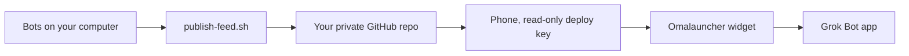

# Grok Bot Omalauncher Widget for Android

*Your Grok Bots, on your Android home screen, in Omalauncher*

A Grok Bot setup for a home-screen widget in [Omalauncher](https://github.com/SimonSchubert/omalauncher) on Android. You need an Android phone with Omalauncher installed.

Pin your favorite bots, scroll the rest, and tap any bot to open its chat. Unread dots show you which bots have something new, so you don't have to open the app to check.

Setup takes one conversation. Add Omaha, the setup bot, answer a few questions, and it builds everything on your Grok Bot computer. Your bot list goes only to a private GitHub repo you own, and your phone gets read-only access to it. Nothing passes through us.


## How it works



The feed is `index.json` (schema version 1) plus 128×128 avatar thumbnails. Descriptions are left out unless you opt in. Server ids, harness, voice ids, secrets, skills, and memory are never written.

## Step-by-step setup

Plan on 10 to 20 minutes. The first time you turn on Omalauncher's Linux it downloads a lot. Omaha, the setup bot, walks you through every step below one at a time and waits for you before moving on.

Omaha will never ask for a password, a GitHub token or a private key. If anything asks you for one, stop.

### 1. What you need first

- **An Android phone** with a 64-bit (arm64) processor, on Android 10 or newer. Most phones from the last few years qualify.
- **Omalauncher**, installed from Google Play and set as your home screen. ([Omalauncher on GitHub](https://github.com/SimonSchubert/omalauncher))
- **Omalauncher's Linux, turned on.** It's an optional part of Omalauncher (Arch Linux ARM, running inside the app). The widget needs it. Look for a Linux option in Omalauncher's settings.
- **The Grok Bot app** for Android, signed in.
- **A free GitHub account.** Make one at [github.com](https://github.com) if you don't have one.

### 2. Add Omaha and say hi

[Add Omaha to your Grok Bots](https://x.ai/bot/baSgCPYf4eBS6CoL9ZzV3). If the link doesn't open on your phone, open it on a computer.

Open a chat with Omaha and say hi. It starts by checking that you have everything from step 1.

### 3. Sign in to GitHub

Omaha keeps your bot list in a private GitHub repo. To make it, Omaha hands you its computer screen. Sign in to GitHub the normal way, then hand the screen back.

Never paste a token or a password into the chat.

### 4. Name your private repo

Omaha suggests `grokbot-widget-feed`. Say "sounds good", or give another name. It stays private.

### 5. Omaha builds your bot list

Nothing to do here. Omaha downloads the widget kit, checks it hasn't been tampered with, and builds the list of your bots. It sets itself a reminder to refresh the list every 3 hours.

### 6. Make a key on your phone

The key lets your phone read your private list, and nothing else.

Open Omalauncher's terminal. With a hardware keyboard, Super+T opens one. There are also terminal tiles you can add to the home screen.

Paste this line and press Enter:

```sh
ssh-keygen -t ed25519 -f ~/grokbot-feed -N ""
```

You should see a few lines ending in a box of symbols. One of them says your identification has been saved in `.../grokbot-feed`.

Then paste this line and press Enter:

```sh
cat ~/grokbot-feed.pub
```

You should see one line that starts with `ssh-ed25519`.

### 7. Send that one line to Omaha

Copy the `ssh-ed25519` line and send it to Omaha. It's safe to share. It's the public half of the key.

Never send anything that contains `PRIVATE KEY`. That half stays on your phone.

Omaha adds it to your repo and tells you "read-only deploy key added".

### 8. Pick a pinned bot (optional)

Omaha asks if you want one bot always at the top. Tell it the bot's exact name, or say none.

### 9. Paste the install line

Omaha sends you one long line. Copy all of it, paste it into Omalauncher's terminal and press Enter.

On success you see:

```text
Grok Bot widget installed. Look on page 2.
```

If you see something else, go to [Troubleshooting](#troubleshooting).

### 10. Find the widget and finish up

- Swipe to page 2 of your home screen. The widget appears there by itself. The first load can take a minute.
- If it says "allow notification access to show unread", tap that line and allow Omalauncher's notification access. That's what shows the unread dots.
- Tap a bot. Its chat opens in the Grok Bot app.

Tell Omaha it worked. You're done.

## Changing your pinned bot later

Ask Omaha. It makes a new install line with the new pin. Paste it into Omalauncher's terminal, the same as step 9. It replaces the old widget file in one go.

## How refresh works

- Omaha republishes your bot list every 3 hours. It stays quiet unless something breaks.
- The widget checks the list every 10 minutes.
- So a new or removed bot shows up within about 3 hours and 10 minutes. To see it sooner, ask Omaha to refresh now.
- Unread dots come straight from Grok Bot app notifications on your phone, so they don't wait for a refresh.

## Troubleshooting

**"Install failed. Nothing was changed."**
Your phone is as it was. Common causes:
- No internet. Check your connection and paste the line again.
- `curl` is missing from Omalauncher's Linux. Paste this, then paste the install line again:
  ```sh
  pacman -S --needed curl coreutils git openssh
  ```
  If it asks to proceed, answer Y.
- Only part of the line was pasted. Copy the whole line from Omaha again.
- The widget download couldn't be reached. Wait a few minutes and try again, or tell Omaha.

**"Stopped: the widget file failed its tamper check. Nothing was installed."**
Stop. Don't try to get around it. Tell Omaha what you saw.

**No widget on page 2**
- Check page 2 again. The widget always goes there.
- Check that the file is there. In Omalauncher's terminal:
  ```sh
  ls ~/.config/omalauncher/widgets/grokbot.owl
  ```
  If it says "No such file", paste the install line again.

**The widget says it can't read the feed, or shows no bots**
- The phone key may not have been added. Ask Omaha to check.
- The repo name in the install line may not match your repo. Ask Omaha for a fresh install line.
- Wait 10 minutes. The widget only checks every 10 minutes.
- Still stuck? Ask Omaha to check the feed.

**No unread dots**
- Allow Omalauncher's notification access (tap the "allow notification access" line on the widget).
- Turn on notifications for the Grok Bot app.

**Tapping a bot doesn't open its chat**
Make sure the Grok Bot app is installed and signed in to the same account as your bots.

## Uninstall / remove the phone key

Ask Omaha. It asks which parts you want removed: the phone's key, the 3-hour refresh, the private repo, or its own copy of the files. It removes only what you say yes to.

On your phone, paste this into Omalauncher's terminal to remove the key and the widget:

```sh
rm ~/grokbot-feed ~/grokbot-feed.pub ~/.config/omalauncher/widgets/grokbot.owl
```

## Manual install

For technical users who want to run the scripts themselves.

You need Python 3, `git`, and the GitHub CLI (`gh`) on the Grok Bot computer. Pillow (`pip install Pillow`) is optional; without it, avatars are skipped and the widget draws a mark from each bot's color and shape. The phone needs Omalauncher's Linux with `curl`, `git` and `openssh` (`pacman -S --needed curl coreutils git openssh`), plus notification access if you want unread dots.

1. Clone a **pinned tag** of this repository. Do not follow a moving branch.

   ```sh
   git clone --depth 1 --branch v0.1.0 https://github.com/rystedtcreative/grokbot-omalauncher-widget
   ```

2. Check the tree before you run anything:

   ```sh
   sha256sum -c checksums.txt
   ```

   Stop if any line is not `OK`.
3. Publish the feed. `OWNER/NAME` must be private. The script refuses a public repo, creates one private repo if it is missing, and pushes only when the feed changed.

   ```sh
   scripts/publish-feed.sh --repo OWNER/NAME
   ```

   The checkout on this computer is `/workspace/grokbot-widget-feed`.
4. On the phone, in Omalauncher's terminal:

   ```sh
   ssh-keygen -t ed25519 -f ~/grokbot-feed -N ""
   cat ~/grokbot-feed.pub
   ```

   On the computer, save that single public line as `phone.pub` and add it as a read-only deploy key. The script also reads the line on stdin, and refuses anything that looks like a private key.

   ```sh
   scripts/add-phone-key.sh --repo OWNER/NAME phone.pub
   ```

5. Print the phone's install line, then paste it into Omalauncher's terminal. Add `--pin "Bot Name"` to pin one bot at the top.

   ```sh
   scripts/phone-install-line.sh --repo OWNER/NAME --ref v0.1.0
   ```

   The line downloads `widget/grokbot.owl` from that tag, checks its sha256 against this checkout, fills in your feed repo and pin, and writes it to `~/.config/omalauncher/widgets/grokbot.owl`. Omalauncher loads it on page 2. It installs nothing if the check fails. To change the refresh interval (`every 10m`), edit that file on the phone.

Run `scripts/publish-feed.sh` again whenever bots change, or schedule it every few hours and stay quiet unless it fails. `scripts/update-checksums.sh` rewrites `checksums.txt` after you change the widget or the scripts. Run it before you tag a release.

`--include-descriptions` adds scrubbed descriptions. Leave it off. Descriptions often contain private instructions, and scrubbing can miss a secret.

## Security, in short

Your bot list only goes to places you control:

- **Your Grok Bot computer**, which already holds your bots. It builds the list.
- **Your private GitHub repo.** The setup refuses to use a public one, and every refresh checks again, so keep it private. If it's ever made public, refreshes stop until you make it private again.
- **Your phone**, which can read that repo but can't change it.

The list holds names, titles, avatars and colors. It never includes your bots' instructions, memory, skills or secrets. Descriptions stay off unless you turn them on. There's no server, account or relay run by the kit's author. For the full details and how to report a problem, see [SECURITY.md](SECURITY.md).


---

Made by Joshua Rystedt at [R Creative](https://rcreative.ai), where we build websites, web apps and AI agents.
